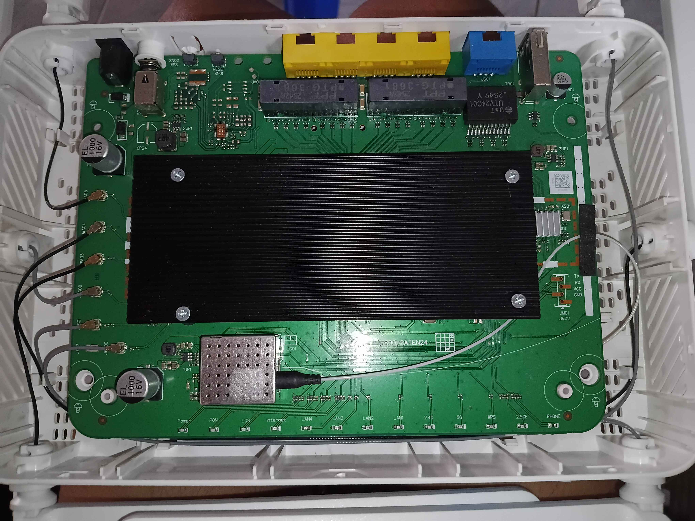
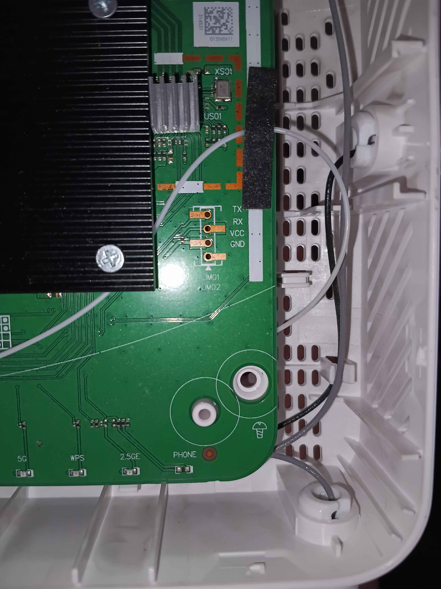

# True Fiber / T3 Technology T626Pro V2 (Thailand Firmware & Modding Archive)

> *full firmware dump, flashables and modded tools for True Fiber T626Pro V2 (Thailand model) so you don't get stuck with isp locks :P*

[-blue.svg)](#)
[](#)
[](#)
[](#)

Inspired by [Blinko1987's repo](https://github.com/Blinko1987/True-Fiber-T626Pro-V1.0.0.5-Firmware) for V1 hardware. Since V2 has almost zero public files online and people keep getting bricked or locked by True's firmware, this repo has everything: dual-bank flash dumps, full SPI NAND images, unbricking files, clean unlocked romfiles, and a modern ARMv7 toolkit ready to drop in :D

---

## ⚡ How to Unlock Telnet & Find UART

If your router is locked down and you need shell access, you can get in either through UART serial or the hidden webpage.

### ⚠️ IMPORTANT SAFETY WARNING
> **NEVER EVER connect a pin to VCC!**  
> Seriously, do not connect the VCC pin from your USB-to-TTL to the board. You will risk frying the UART pins or the entire SoC! Only connect **GND**, **TX**, and **RX**.

### 1. Locating the UART Header
You can solder header pins or use pogo pins / Dupont wires with your USB-to-TTL adapter:

| Board Overview | UART Header Closeup |
| :---: | :---: |
|  |  |

* **Baud Rate:** `115200` (8 data bits, no parity, 1 stop bit, no flow control)
* **Logic Level:** 3.3V TTL (Make sure your USB adapter jumper is set to 3.3V, not 5V!)
* **Connections:**
  * Router `GND` ➔ USB-TTL `GND`
  * Router `TX` ➔ USB-TTL `RX`
  * Router `RX` ➔ USB-TTL `TX`
  * Router `VCC` ➔ **LEAVE DISCONNECTED!**

### 2. Steps to Unlock Telnet via UART Shell
Once you plug the power in and open your serial terminal (`picocom -b 115200 /dev/ttyUSB0` or PuTTY on Windows):
1. Wait for it to boot and hit **Enter** to get the root BusyBox prompt (`#`).
2. Run these tcapi commands to enable Telnet permanently:
   ```sh
   /userfs/bin/tcapi set Account_TelnetEntry Active Yes
   /userfs/bin/tcapi set Account_TelnetEntry telnet_port 23
   /userfs/bin/tcapi set Account_TelnetEntry telnet_passwd admin
   /userfs/bin/tcapi commit Account_TelnetEntry
   /userfs/bin/tcapi set Firewall_Entry lan_telnet_enable 1
   /userfs/bin/tcapi commit Firewall_Entry
   /userfs/bin/tcapi save
   ```
3. Now Telnet is active on port 23 across your LAN!

*(Tip: If you already have Web UI access, you can also just visit the hidden page directly at `http://192.168.1.1/cgi-bin/true-page/advance/telnet.asp` to toggle Telnet on!)*

---

## 📂 Repository Contents

```text
.
├── 1_WebUI_and_TFTP_Flashable/
│   ├── tclinux_v1.0.07_stock_bank0.bin         # Official Web GUI upgrade format (Bank 0)
│   ├── tclinux_v1.0.07_modded_bank1.bin        # Modded Web GUI upgrade (Cleaned, no portal)
│   └── sha256sums.txt
│
├── 2_Full_SPI_NAND_Programmer_Dump/
│   ├── full_spi_nand_256mb_programmer.7z       # 256MB dump for CH341A / T48 / T56 programmer
│   └── sha256sums.txt
│
├── 3_Raw_MTD_Partitions/                       # Individual partition images for nandwrite / flashcp
│   ├── mtd0_bootloader.bin                     # U-Boot bootloader & boot env
│   ├── mtd1_romfile.bin                        # Factory romfile & default XML config
│   ├── mtd2_kernel.bin / mtd5_kernel_slave.bin # Linux 4.4.115 kernels (Bank 0 / Bank 1)
│   ├── mtd3_rootfs.bin / mtd6_rootfs_slave.bin # SquashFS root filesystems
│   ├── mtd4_tclinux.bin / mtd7_tclinux_slave   # Complete bank containers (32MB)
│   ├── mtd8_config.bin                         # Persistent NVRAM config
│   ├── mtd9_ubifs.bin                          # Persistent writable overlay (/usr/ubifs)
│   ├── mtd10_rootfs_data.bin                   # JFFS2 rootfs data partition
│   ├── mtd11_custom_app.bin                    # Modern toolkit partition (48MB)
│   └── mtd12_reservearea.bin                   # Reserved & BMT/BBT pool
│
├── 4_Dropin_ModPack_NoFlash/                   # Drop-in toolkit (Works without flashing firmware)
│   ├── custom_app_toolkit.tar.gz               # htop, nano, rsync, curl, ttyd, tcpdump, etc.
│   └── install_toolkit.sh                      # 1-liner installer script
│
├── 5_Unlocked_Config/
│   ├── clean_unlocked_romfile.xml              # Sanitized XML with TR-069 ACS removed
│   └── factory_stock_romfile.cfg               # Stock default romfile archive
│
├── images/                                     # Board photos and UART pinout diagrams
│   ├── uart_board_overview.jpg
│   └── uart_header_closeup.jpg
│
├── TheFileInsideMtds/                          # Unpacked source and rootfs filesystem trees
│
├── FLASHING_GUIDE.md                           # Detailed flashing & debricking manual
└── README.md
```

---

## 🛠️ Included ModPack Toolkit (ARMv7 Soft-Float)

All utilities are static-PIE compiled specifically for EcoNet EN7529CT (AArch32 soft-float) so they never crash with illegal instruction:

* **Monitoring & Administration:** `htop` (v3.3.0), `vnstat` & `vnstatd` (v1.18), `strace` (v6.7)
* **Networking & Diagnostics:** `iperf3` (v3.22), `tcpdump` (v4.99.4 + libpcap), `drill` / `dig` (v1.8.3), `curl` (v8.7.1 with OpenSSL 1.1.1w + Mozilla CA certs), `socat` (v1.8.0), `ethtool` (v5.15), `arp-scan` (v1.10.0)
* **Storage & File Transfer:** `rsync` (v3.2.7), `vsftpd` (v3.0.5), `mkfs.ext4` & `fsck.ext4` (e2fsprogs v1.47.0)
* **Editing & Remote Access:** `nano` (v7.2), `Dropbear SSH` (v2024.85), `ttyd` Web Terminal on port 7681

---

## 🚀 Quick Start & Flashing Guide

Check out [FLASHING_GUIDE.md](file:///run/media/moonlight/GameLibrary/Firmware%20works/FLASHING_GUIDE.md) for step-by-step instructions:
* **Web UI Upgrade:** Upload `1_WebUI_and_TFTP_Flashable/tclinux_v1.0.07_modded_bank1.bin` in the web menu.
* **No-Flash Toolkit:** Run `install_toolkit.sh` over SSH or Telnet to get all tools instantly.
* **Serial / TFTP Recovery:** Unbrick soft-bricked units using U-Boot TFTP.
* **Hardware Programmer:** Unbrick completely dead boards with the full 256MB SPI NAND image.
* And let me clearify one thing, Yes i use ai, I use ai to help with this while also researching so pelase. i did some Software installation and firmware flashes but the firmware dumps and many things are hard so i had to use ai. but of course for UART headers i did a real research, You can use usb ttl serial, or... you can solder, depending how you want it
* Also if you accidently flashed this firmware on a wrong hardware, I will not be responsibile for this. It's your own equipment.
